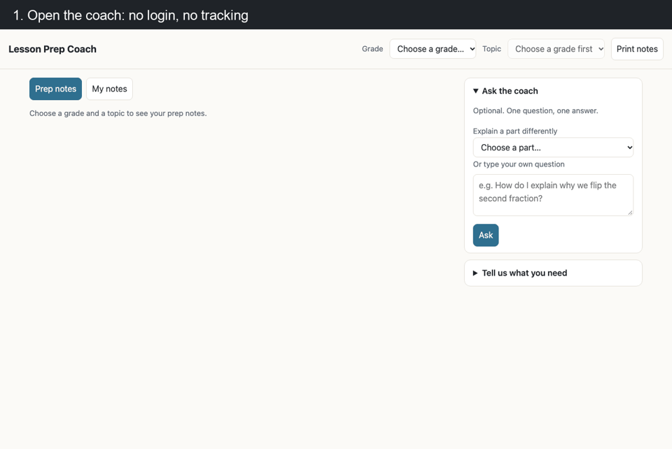

# Lesson Prep Coach

A coach that helps math teachers prepare tomorrow's lesson: alone, in a browser, with no chatbot, no tests and no login.
Pick a grade and a topic, and get checked prep notes laid out the way the lesson is taught.



**Guiding principle: trustworthy before anything else.** A teacher repeats what the coach says in front of a class, so a wrong answer is worse than no answer.

## What a teacher gets

1. **Plan:** what the lesson covers + a **40-minute lesson plan**. The last 10 minutes are always extra examples and questions.
2. **Short theory:** the idea, *why* it works, one worked example.
3. **Each part, in teaching order:** 2 ways to explain it, a worked example, a drawing where it helps (teachers can edit it), 2 common mistakes, 3 questions students may ask, and a check question for the class (answer hidden, nothing scored).
4. **Extras:** resources (Khan Academy, Wolfram|Alpha, GeoGebra, Wikipedia, YouTube), and an optional side panel to ask one question or send feedback.
5. **My notes tab:** the teacher's own notes and sketch pad. Saves are verified, and everything stays on their device.

Grades 1–10, 97 Common Core topics. 90 are ready; 7 are pending (see Limitations).

## Run

```bash
python3 -m venv .venv && .venv/bin/pip install -r requirements.txt
.venv/bin/uvicorn coach.server:app --port 8000            # http://127.0.0.1:8000
.venv/bin/python -m unittest tests.test_check tests.test_qa tests.test_videos tests.test_promote tests.test_api   # 19 tests, no LLM
node tests/notes_save.test.mjs                            # My notes saving (3 storage cases)
.venv/bin/python -m evals.run                             # answer quality → evals/results.md
```
Generating notes and live answers needs the [Claude Code CLI](https://claude.com/claude-code), logged in (the development LLM backend).

## The brief's delivery items

| Item asked for | Where it is answered |
|---|---|
| How to run it | "Run" above |
| Design and trade-offs | "How it works" below; 29 decisions with the alternatives rejected in [docs/research-notes.md](docs/research-notes.md) §1 |
| What was skipped, and why | "Limitations" and "Future scope" below |
| Time spent | Build: 16:46–17:50 by the git log (about 1 h). Research and planning came before, in the same session, not clocked. Per-step times in [MEMORY.md](MEMORY.md) |
| How we know the answers are good | 1) Notes are grounded in checked lessons. 2) **Every** example, check question and extra example is recomputed with SymPy, and a sheet that fails is never saved (90/90 pass). 3) The structure is enforced by code. 4) Eval: 10 teacher questions with traps, graded by a stronger model: **correct 10/10**. The eval caught one real error ("usually" instead of "never"), now fixed. See [evals/results.md](evals/results.md) |
| Cost per teacher per month, and how to lower it | **~$0.006** realistic, **≤ $0.04** worst case (50 questions a month). $2k a month is a hard limit in code. Notes are made once ($8.26 for 90 topics) and shared by all teachers. Lowered by caching, trimmed context, a small model on the live path, and Batch API for notes. Full model: [docs/cost-model.md](docs/cost-model.md) |
| What data the coach handles, and where it goes | See "Data, in plain language" below |

## How it works

```
curriculum/  concepts (standard-neutral) · standards/ccss.yaml (code → grade → concept) · lessons/ (our CC BY texts)
coach/sheet.py   concept → grounded prompt (Sonnet) → JSON → check.py → content/<topic>.json  (prepared before launch)
coach/check.py   structure, SymPy math, drawing values, no model-written URLs
coach/qa.py      live question: validate → 50/month cap → strict cache (indexed) → $ budget stop → Haiku
coach/llm.py     the only place a model is called (swap the backend here)
coach/server.py  FastAPI, thin      web/index.html  one page, no framework, JSXGraph drawings
```

Key trade-offs:
- **Notes are pre-generated and shared, not generated per teacher.** No waiting, nothing unchecked goes live, and the cost doesn't grow with users. The price is that topics must be prepared ahead.
- **Strict question cache:** an answer is reused only for a near-identical question with identical numbers. It misses paraphrases, but "1/2 > 1/3" can never get the answer to "1/3 > 1/2".
- **The AI supplies only values for fixed drawing templates and never writes code or links.** Fewer kinds of visual, but nothing unsafe or invented.
- **No accounts.** Teachers' own notes live in their browser. That's private, but they don't follow the teacher to another device.

## The four review criteria

| Criterion | How it is addressed |
|---|---|
| **Product judgment & communication** | Built for the real job (preparing tomorrow's lesson), shaped by the brief's constraints: notes first and chat second, no scores, no login, a 40-minute plan the teacher can follow. Every decision is logged with its reason and the rejected alternatives ([research-notes](docs/research-notes.md)) |
| **Architecture & extensibility** | One function per job. A new country = one mapping file. A new topic = one YAML line. A new model = `llm.py`. A new drawing = one template. Only `sheet.save()` writes sheets (atomically) |
| **LLM use, answer quality & cost** | Strong model once (notes), small model live (answers), deterministic checks around both, an eval with run history, measured costs ($0.00125 per answer before trimming the context), and a hard budget stop |
| **Documentation & compliance** | Open content only (CC BY lessons, CCSS codes, links to the rest). No personal data stored. Typed questions are promoted to FAQs only after educator review. Internal errors never reach teachers. AI use disclosed (see Data) |

## Data, in plain language

- **No names, emails or accounts.** The browser holds a random ID, used only to count questions per month.
- **A typed question** is sent with the topic's short notes to the AI provider (Anthropic, in this prototype). Nothing identifying the teacher is sent. Question and answer are stored on our server to answer repeats.
- **Feedback text** is stored on our server; teachers are asked not to include personal details.
- **My notes and sketches** never leave the teacher's browser.
- **YouTube** is contacted when content is prepared, not when a teacher visits; a teacher's browser only reaches YouTube if they click a link.
- **Before launch:** an EU-region LLM provider with no training on inputs; a retention period for stored questions; educator review of every sheet; the terms of use state the content is AI-assisted (EU AI Act).

## Tools used

- **Building:** Claude Code (Claude Opus 5.5) as pair programmer. Every step is logged in [MEMORY.md](MEMORY.md).
- **In the product:** Claude Sonnet (notes, eval judge), Claude Haiku (live answers), via the Claude Code CLI.
- **Stack:** Python, FastAPI, SQLite, SymPy (math checks), PyYAML, JSXGraph (drawings).
- **Content:** OpenStax (CC BY), Common Core codes, YouTube Data API (optional).
- **Demo GIF:** Playwright + Pillow (dev-only; [docs/make_demo_gif.py](docs/make_demo_gif.py)).

## Limitations

- 7 grade 9–10 topics are still "coming soon": the development account hit its spend limit. Run `python -m coach.sheet <id>` once it resets.
- The eval has 10 cases, one judge from the same model family, and English only. The trimmed answer context hasn't been re-evaluated yet (same spend limit).
- YouTube videos need a `YOUTUBE_API_KEY`. Without it, a YouTube search link is shown.
- The 50-question cap uses an anonymous browser ID, so anyone can reset it (or drain the shared budget) until there's a login.
- Notes are reviewed only by automatic checks, not yet by a math educator.
- SQLite on one server; the CLI backend is for development only.
- Some function graphs zoom out too far (e.g. a parabola shown up to y = 160).

## Future scope

Answers in the teacher's own language (and local notation) · login (Akelius SSO) so notes follow the teacher and the cap holds · an educator review screen · more country standards · semantic question matching · a self-hosted Excalidraw whiteboard · a production LLM backend (Anthropic API or a hosted open-weight model, chosen by the eval).

---
Deeper reading: [research notes and decision log](docs/research-notes.md) · [cost model](docs/cost-model.md) · [eval results](evals/results.md) · [step log](MEMORY.md) · [sources and licences](curriculum/ATTRIBUTION.md)
